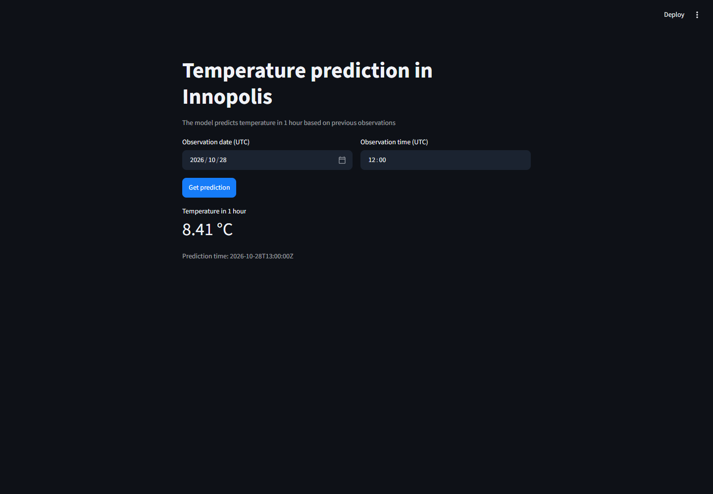
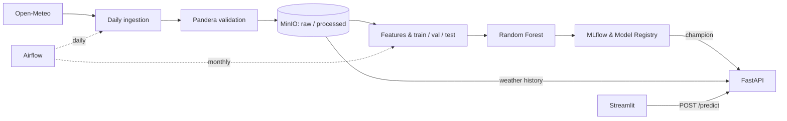
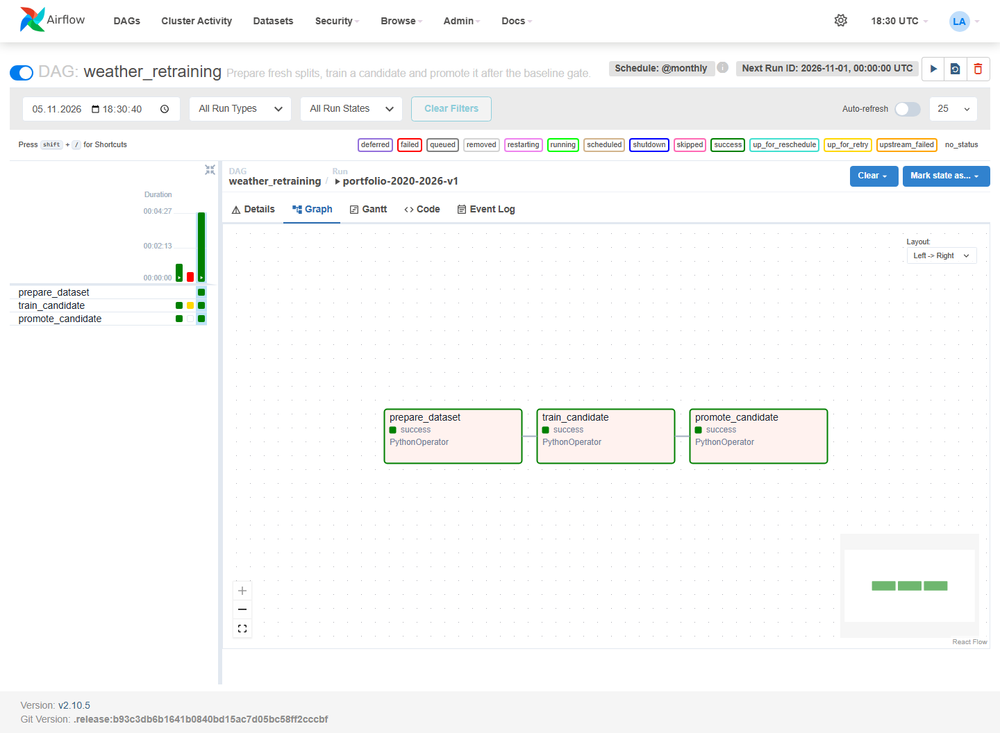
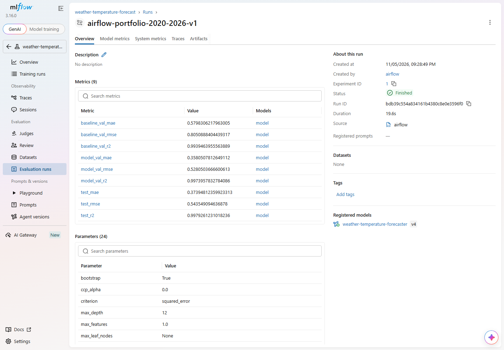

# Innopolis Weather Forecasting

A small weather forecasting project for Innopolis, Tatarstan. Given the weather
at a particular hour, the model predicts the temperature one hour later.

The model itself is a Random Forest. Most of the work here is around it: collecting
weather history, keeping track of datasets, scheduling training and serving the
result through an API. Everything runs locally with Docker Compose.



## How it works

Open-Meteo supplies the hourly weather history. Raw data goes into MinIO, then
passes Pandera validation before being saved to the processed layer. Each Parquet
file holds one UTC day.

Airflow runs ingestion daily and retraining monthly. Before training, it builds
a new dataset from the processed history and splits it into train, validation
and test sets in chronological order. The model has to beat a simple baseline:
next hour's temperature is the same as this hour's.

MLflow stores the model, parameters and metrics. A model that passes the check
gets the `champion` alias. FastAPI loads it at startup; Streamlit sends prediction
requests to the API.



Features include the current weather, temperature lags of 1, 2, 3, 6, 12 and
24 hours, and calendar features in the local timezone, `Europe/Moscow`.
Training and prediction use the same feature-building code.

## Results

The dataset was collected from **2020-01-01 to 2026-10-28**: 59,832 hourly
observations and 25 features. After creating the lags and target, the usable
train / validation / test sets contain 41,857 / 8,974 / 8,975 rows.

| Model and split | MAE, °C | RMSE, °C | R² |
| --- | ---: | ---: | ---: |
| Persistence baseline, validation | 0.5798 | 0.8051 | 0.99395 |
| Random Forest, validation | 0.3581 | 0.5281 | 0.99740 |
| Random Forest, test | 0.3739 | 0.5435 | 0.99793 |

The forest reduces validation MAE by **38.2%** compared with persistence.
It uses 64 trees, a maximum depth of 12, a minimum leaf size of 4 and seed 143.



*Airflow: a completed monthly run, from fresh train/validation/test splits to model training and promotion.*



*MLflow: baseline and model metrics, training parameters and the registered model version from the same run.*

## Running it

You'll need Docker Desktop with Linux containers, or Docker Engine with Compose v2.
Run the commands below from the repository root. Python runs inside the containers.

### First launch

Copy `.env.example` to `.env` and set the local passwords. In PowerShell:

```powershell
Copy-Item .env.example .env
```

On Linux or macOS, use `cp .env.example .env`.

Build the images and start storage, MLflow and Airflow:

```shell
docker compose build
docker compose up -d minio mlflow airflow-postgres airflow-webserver airflow-scheduler
```

The first build takes a while. MinIO is compiled from the pinned official source
release because its old public Docker image is no longer available. The
`airflow-init` service prepares the metadata database and creates the login user.

Load the weather history:

```shell
docker compose exec airflow-scheduler python -m weather_forecasting.datasets.backfill --start-date 2020-01-01 --end-date 2026-10-28
```

These dates reproduce the run shown above. For a newer snapshot, move the end date
forward, leaving seven full UTC days for the archive to catch up.

Open [Airflow](http://localhost:8080), sign in with `AIRFLOW_ADMIN_USERNAME` and
`AIRFLOW_ADMIN_PASSWORD` from `.env`, enable `weather_retraining` and trigger it.
For the fixed snapshot above, set its `end_date` parameter to `2026-10-28`.
Leaving it blank uses the archive cutoff for that run.

You can also start it from the terminal after loading history through the current
archive cutoff:

```shell
docker compose exec airflow-scheduler airflow dags unpause weather_retraining
docker compose exec airflow-scheduler airflow dags trigger weather_retraining
```

Wait for `prepare_dataset`, `train_candidate` and `promote_candidate` to finish.
Then start the API and UI:

```shell
docker compose up -d api app
```

Open [Streamlit](http://localhost:8501) and choose a time within the loaded history.
The model needs the observation at that time and the preceding 24 hours.

### After setup

Start everything with:

```shell
docker compose up -d
```

Enable `weather_ingestion` in Airflow for daily updates. Retraining runs monthly
and creates fresh splits from the history starting in 2020. If the stack has been
offline, backfill the missing days before the next training run.

After a new model is promoted, restart the API to load it:

```shell
docker compose restart api
```

Stop the stack with `docker compose down`. Data stays in the named volumes;
adding `-v` deletes it.

## Service addresses

| Service | Address |
| --- | --- |
| Streamlit | [localhost:8501](http://localhost:8501) |
| FastAPI docs | [localhost:8000/docs](http://localhost:8000/docs) |
| Airflow | [localhost:8080](http://localhost:8080) |
| MLflow | [localhost:5000](http://localhost:5000) |
| MinIO console | [localhost:9001](http://localhost:9001) |

MinIO uses `MINIO_ROOT_USER` and `MINIO_ROOT_PASSWORD` from `.env`.
The published ports are bound to localhost.

To check the API:

```shell
curl http://localhost:8000/health
```

To request a prediction from PowerShell:

```powershell
Invoke-RestMethod -Method Post -Uri http://localhost:8000/predict -ContentType 'application/json' -Body '{"timestamp":"2026-10-28T12:00:00Z"}'
```

The response includes the input timestamp, the next-hour timestamp and the predicted
temperature in °C. This example returned **8.41 °C** in the recorded run.

## Where things live

```text
weather_forecasting/       data processing, training and prediction code
services/airflow/          DAGs, Dockerfile and dependencies
services/api/              FastAPI application
services/app/              Streamlit application
services/mlflow/           MLflow server image
services/minio/            MinIO source build
docs/images/              application and pipeline screenshots
docker-compose.yml        local stack
.env.example               environment template
```

MinIO keeps daily weather under `raw/weather/` and `processed/weather/`.
Prepared splits live under `processed/ml/dataset_id=.../`, alongside their manifest
and `_SUCCESS` marker. Each training run gets its own dataset version; retries
reuse the completed version. Airflow passes dataset IDs through XCom rather than
moving DataFrames between tasks.

## About the data

This version works with archived weather. You choose a past observation and get
a prediction for the following hour; it doesn't fetch live weather for a forecast
from the current time. Archive data arrives with a delay, so ingestion leaves a
seven-day gap.

The source is the [Open-Meteo Historical Weather API](https://open-meteo.com/en/docs/historical-weather-api).
It provides reconstructed weather data for the selected coordinates
(`55.752085, 48.744618`), rather than measurements from a sensor in the city.
